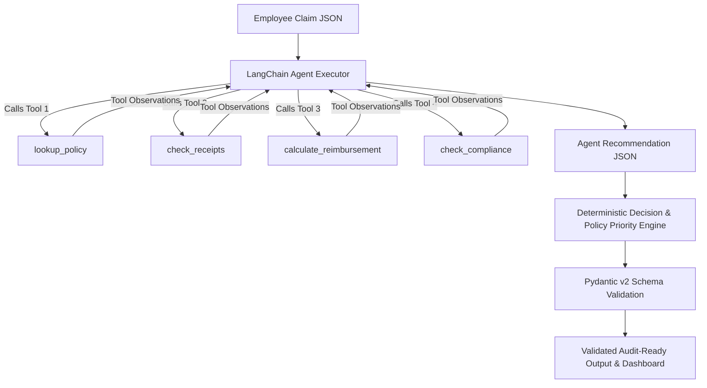

# ✈️ Travel Reimbursement Approval Agent

[](sanketChavan.ipynb)
[](https://python.langchain.com/)
[](https://aistudio.google.com/)
[](https://docs.pydantic.dev/)

> **Candidate:** Sanket Chavan  
> **Role:** GenAI / AI Engineer Case Study  
> **Deliverable:** `sanketChavan.ipynb` (Single Standalone Executable Notebook)

---

## 📌 Overview

This repository contains the solution for the **Travel Reimbursement Approval Agent Case Study**. The system evaluates employee travel expense claims against corporate travel policy rules (Appendix A) using a hybrid **GenAI Agent + Deterministic Engine** pattern implemented in a single, self-contained Jupyter notebook (`sanketChavan.ipynb`).

### 🎯 Key Deliverable Note
As instructed in the assessment guidelines:
> *"Single Notebook uploaded on GitHub with working repo (Shareable link) is the only deliverable (`sanketChavan.ipynb`) we will assess."*

The notebook `sanketChavan.ipynb` is **100% self-contained and directly executable** from top to bottom. It installs all required packages automatically, requires no external file dependencies, cleanly handles API keys, and includes pre-rendered outputs, test suite results, and interactive dashboards.

---

## 🚀 Quick Start & Execution

You can run `sanketChavan.ipynb` directly in **Google Colab**, **VS Code**, or **JupyterLab / Notebook**.

### Option A: Run in Jupyter / VS Code (Local)

1. **Clone the repository:**
   ```bash
   git clone https://github.com/sanketjc2000/travel-Reimbursement-Agent-HCL.git
   cd travel-Reimbursement-Agent-HCL
   ```

2. **Open and Run the Notebook:**
   ```bash
   jupyter notebook sanketChavan.ipynb
   ```
   - Click **Run All** (Cell 2 automatically installs all required dependencies: `langchain`, `langchain-google-genai`, `pydantic`, `pandas`, `matplotlib`, etc.).
   - In Cell 4, provide your **Google Gemini API Key** (obtainable from [Google AI Studio](https://aistudio.google.com/apikey)).
   - The notebook seamlessly detects `.env`, environment variables, Colab Secrets, or prompts interactively via secure `getpass`.

### Option B: Run in Google Colab

1. Upload `sanketChavan.ipynb` to [Google Colab](https://colab.research.google.com/).
2. Add your `GOOGLE_API_KEY` under Colab's **Secrets (🔑)** tab or enter it when prompted in Cell 4.
3. Select **Runtime → Run all**.

### Option C: Run Interactive Streamlit Web UI (Dynamic Claim Builder)

For interactive graphical evaluation and dynamic claim creation:
```bash
streamlit run app.py
```
- **🎯 Dynamic Structured Form Builder**: Create and evaluate custom travel reimbursement claims dynamically. Add/remove expense line items, toggle receipts, select flight fare classes (`economy` vs `business/first`), and specify per-diem counts (nights/days).
- **📋 Appendix B Benchmark Explorer**: Inspect and evaluate benchmark claims with 1 click.
- **📊 4-Panel Results Dashboard**: View interactive decision distributions, financial breakdowns, and confidence scores across benchmark and dynamic claims.
- **🖼️ Saved UI Artifacts**: Saved as [`UI SS_1.png`](UI%20SS_1.png) (Dashboard) and [`UI SS_2.png`](UI%20SS_2.png) (Streamlit Dynamic Claim Builder).

---

## 🏛️ System Architecture

The solution uses a **Single-Agent with Tool-Calling + Deterministic Safety Layer** architecture:



### 1. LangChain Tool-Calling Agent
- **LLM:** Google Gemini (`ChatGoogleGenerativeAI` with `temperature=0.0` for reproducibility).
- Uses `create_tool_calling_agent` with native function-calling.
- Proactively invokes all 4 specialized tools for policy lookup, receipts verification, arithmetic calculations, and compliance rules.

### 2. Four Specialized Agent Tools
| Tool Name | Responsibility | Policy Rules Enforced |
|---|---|---|
| `lookup_policy` | Queries policy rules by category/keyword with full-registry fallback | All 12 Appendix A rules |
| `check_receipts` | Verifies mandatory receipt presence (`POL-REC-01`, `POL-REC-02`) | POL-REC-01, POL-REC-02 |
| `calculate_reimbursement` | Computes eligible vs deducted amounts, enforces daily per-diem caps | POL-CAT-01, POL-CAT-02, POL-PD-01, POL-PD-02 |
| `check_compliance` | Verifies submission window, flight class policy, and approval thresholds | POL-TIM-01, POL-AIR-01, POL-AIR-02, POL-APR-01, POL-APR-02, POL-APR-03 |

### 3. Deterministic Safety & Validation Layer
- **No LLM Math Hallucinations:** All financial computations (caps, deductions, sums) are executed using deterministic Python functions.
- **Strict Decision Priority Hierarchy:**
  1. `REJECT` (if all items ineligible or untimely submission under strict policy)
  2. `MANUAL_REVIEW` (business/first-class flights, missing required receipts, eligible amount > $2,000, high ambiguity)
  3. `PARTIAL_APPROVE` (per-diem cap overages, ineligible sub-items with valid business items)
  4. `APPROVE` (fully compliant claims with all receipts and within limits)
- **Pydantic Guardrail:** Enforces schema contracts (`claim_id`, `decision`, `approved_amount`, `deducted_amount`, `missing_docs`, `policy_refs`, `confidence`, `explanation`, `tools_used`).

---

## 📊 Evaluation Results (Appendix B Claims)

| Claim ID | Employee Purpose | Claimed | Decision | Approved | Deducted | Missing Docs | Policy References |
|:---:|:---|:---:|:---:|:---:|:---:|:---:|:---|
| **CLM-001** | Industry Conference (2 days) | $1,110.00 | **APPROVE** | **$1,110.00** | $0.00 | None | `POL-APR-02`, `POL-CAT-01`, `POL-PD-01`, `POL-PD-02` |
| **CLM-002** | Client On-Site (Meals over cap) | $765.00 | **PARTIAL_APPROVE** | **$665.00** | $100.00 | None | `POL-APR-02`, `POL-CAT-01`, `POL-PD-01` |
| **CLM-003** | Team Offsite (Missing receipt) | $1,280.00 | **MANUAL_REVIEW** | **$0.00** | $0.00 | `rec-005` | `POL-APR-02`, `POL-CAT-01`, `POL-REC-01` |
| **CLM-004** | London Executive Briefing (Business Class) | $4,850.00 | **MANUAL_REVIEW** | **$0.00** | $0.00 | None | `POL-AIR-02`, `POL-APR-03`, `POL-CAT-01`, `POL-PD-01` |
| **CLM-005** | Tech Expo (Alcohol & Personal items) | $310.00 | **REJECT** | **$0.00** | $310.00 | None | `POL-CAT-02` |

> *Note for `MANUAL_REVIEW`: Financial fields default to `$0.00` pending human auditor disposition, with provisional amounts cited in the explanation.*

---

## 🧪 Test Suite & Results

The notebook includes a built-in automated test suite verifying:
- ✅ Schema conformity & valid enum values across all claims
- ✅ Non-empty policy citations (`POL-*`) and tracked tool names
- ✅ Mathematical invariant: `approved_amount + deducted_amount <= total_claimed`
- ✅ Exact arithmetic checks on per-diem cap deductions (e.g., CLM-002: $100.00 deducted)
- ✅ Correct routing of policy exceptions (CLM-003 missing receipt, CLM-004 business class flight)
- ✅ 100% test pass rate recorded directly in the notebook output

---

## 📁 Repository Structure

```
travel-Reimbursement-Agent-HCL/
├── sanketChavan.ipynb    # Main deliverable (Self-contained, runnable notebook)
├── app.py                # Interactive Streamlit Web UI (Dynamic Claim Builder)
├── UI SS_1.png           # User Interface Screenshot 1: Results Dashboard
├── UI SS_2.png           # User Interface Screenshot 2: Streamlit Dynamic Claim Builder
├── README.md             # Project documentation and architectural overview
└── .gitignore            # Git exclusion configuration (.env, cache)
```
